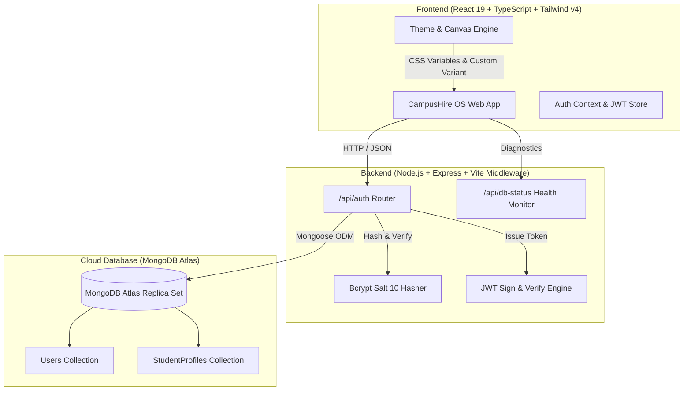
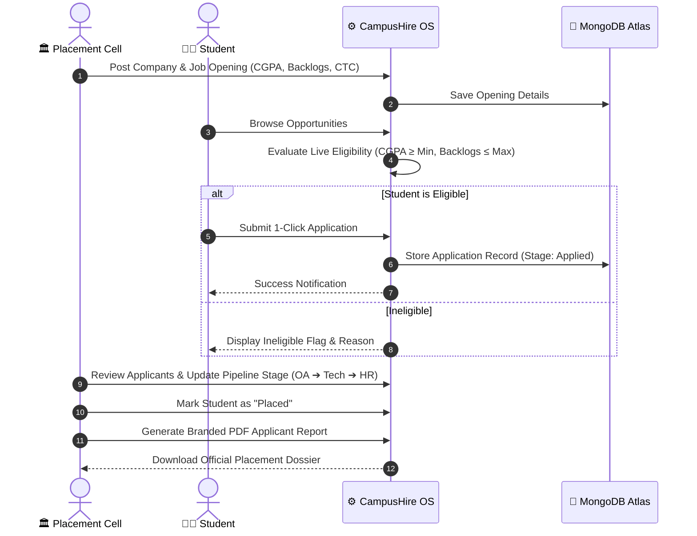

# 🎓 CampusHire OS — Smart College Placement Management Platform

[](https://campushire-os.ai.studio)
[](LICENSE)
[](https://www.mongodb.com/cloud/atlas)
[](https://react.dev)
[](https://www.typescriptlang.org)
[](https://tailwindcss.com)

> **One platform. Every opportunity.**  
> A high-performance, full-stack placement operations platform built for modern colleges and universities. Automates eligibility verification, recruitment drive pipelines, live interview scheduling, student profiles, and placement intelligence reports with real-time MongoDB Atlas persistence.

🌐 **Live Production Link:** [https://campushire-os.ai.studio](https://campushire-os.ai.studio)

---

## 🌟 Key Highlights & Screen Preview

| 🏛️ Placement Officer Console | 👨‍🎓 Student Career Portal |
| :---: | :---: |
| Full administrative control over drives, companies, eligibility criteria, multi-stage pipelines, and instant PDF applicant roster generation. | Personalized student dashboard, live opening discovery with automatic eligibility checks, application tracking, and profile management. |

```
┌─────────────────────────────────────────────────────────────────────────────┐
│ 🎓 CampusHire OS                       [🟢 MongoDB Atlas]  [🎨 Theme] [👤]  │
├───────────────┬─────────────────────────────────────────────────────────────┤
│ 📊 Dashboard  │  ⚡ Active Placement Season 2026                            │
│ 🏢 Companies  │  ┌───────────────┐ ┌───────────────┐ ┌────────────────────┐ │
│ 💼 Drives     │  │ 240+ Students │ │ 24 Companies  │ │ 18 Active Openings │ │
│ 📑 Applicants │  └───────────────┘ └───────────────┘ └────────────────────┘ │
│ 👥 Directory  │                                                             │
│ 📈 Analytics  │  📋 Recruitment Pipeline (Applied ➔ OA ➔ Tech ➔ HR ➔ Placed) │
│ 📢 Broadcasts │  📄 One-Click Formal PDF Applicant Reports with Letterhead  │
└───────────────┴─────────────────────────────────────────────────────────────┘
```

---

## 🚀 Key Features

- **🔐 Dual-Role Authentication (Admin & Student):**
  - Secure registration & login powered by **MongoDB Atlas**, **Bcrypt** (10 salt rounds), and signed **JWT (JSON Web Tokens)**.
  - Live status indicator displaying database cluster health, replica set host, and active connection state.
- **🎯 Automated Eligibility Gatekeeper:**
  - Evaluates student CGPA, active backlogs, historical backlogs, course, and department against corporate drive criteria in real time.
  - Displays instant eligibility badges: `Eligible` vs `Ineligible (Reason: Active backlogs > 0)`.
- **💼 End-to-End Application Tracking Pipeline:**
  - Interactive stage manager: `Applied` ➔ `Shortlisted` ➔ `Online Assessment` ➔ `Technical Interview` ➔ `HR Round` ➔ `Offered / Placed`.
  - Batch status updater with notes, test scores, and interview time slots.
- **📄 Professional PDF Roster Generation:**
  - Built-in `jsPDF` and `AutoTable` engine to generate formal, branded applicant dossiers with academic breakdown, contact info, and signature blocks.
  - CSV / Excel export for external campus records and corporate recruiters.
- **🎨 Dynamic Theme & Background Engine:**
  - **Tailwind CSS v4** class-based dark mode engine with instant zero-flicker transitions.
  - 5 Canvas Background Presets:
    - 🏢 **Tech Slate** (`#f8fafc` / `#0b0f19`)
    - 📜 **Warm Sand / Campus Ivory** (`#faf7f2` / `#151310`)
    - 🌌 **Midnight Blue** (`#f0f4f9` / `#080d1a`)
    - 🍃 **Emerald Sage** (`#f2f8f4` / `#061510`)
    - 🖤 **OLED Pure Black** (`#000000`)
  - 6 Vibrant Accent Colors: Indigo, Sky Blue, Violet, Emerald, Rose, Amber.
- **📊 Placement Intelligence & Analytics:**
  - Department-wise placement percentage, average/highest CTC salary brackets, top recruiter breakdown, and real-time audit trail.

---

## 🛠️ Tech Stack & Architecture

### Frontend
<p align="left">
  
  
  
  
  
</p>

### Backend & Middleware
<p align="left">
  
  
  
  
</p>

### Database & Cloud
<p align="left">
  
  
</p>

---

## 📐 Project Flow Diagrams

### 1. System Architecture Diagram



### 2. Recruitment & Placement Workflow



---

## 📂 Project Directory Structure

```
├── .env.example               # Environment template
├── LICENSE                    # MIT License
├── README.md                  # Project documentation
├── index.html                 # HTML Entry Point
├── package.json               # Dependencies and scripts
├── server.ts                  # Express backend & Vite middleware
├── server/
│   ├── db/
│   │   └── connection.ts      # MongoDB Atlas connection manager & fallback
│   ├── models/
│   │   ├── StudentProfile.ts  # Mongoose model for Student Profiles
│   │   └── User.ts            # Mongoose model for User Accounts & Bcrypt
│   └── routes/
│       └── auth.ts            # /api/auth registration, login & status routes
└── src/
    ├── components/
    │   ├── admin/             # Admin console (Pipeline, Drives, PDF Exports)
    │   ├── layout/            # Navbar, Sidebar, Theme customizer
    │   ├── public/            # Landing page, Auth modal
    │   └── student/           # Student portal (Applications, Profile, Jobs)
    ├── context/
    │   ├── AuthContext.tsx    # Auth state & MongoDB Atlas session sync
    │   └── ThemeContext.tsx   # Canvas background & color switcher
    ├── services/
    │   ├── pdfExport.ts       # jsPDF campus report generator
    │   └── storage.ts         # Persistent data layer
    └── index.css              # Tailwind v4 directives & CSS variables
```

---

## ⚡ Getting Started (Local Setup)

### Prerequisites
- [Node.js](https://nodejs.org/) (v18.0.0 or higher)
- [npm](https://www.npmjs.com/) or [bun](https://bun.sh/)
- A free [MongoDB Atlas](https://www.mongodb.com/cloud/atlas) account (or local MongoDB)

### 1. Clone the repository
```bash
git clone https://github.com/sonukr7435/campushire-os.git
cd campushire-os
```

### 2. Install dependencies
```bash
npm install
```

### 3. Configure environment variables
Create a `.env` file in the root directory:
```env
# MongoDB Atlas Connection URI
MONGODB_URI="mongodb+srv://<username>:<password>@cluster0.mongodb.net/campushire?retryWrites=true&w=majority"

# JWT Secret for Session Tokens
JWT_SECRET="your-super-secret-jwt-key"

# Port (defaults to 3000)
PORT=3000
```

### 4. Start the Development Server
```bash
npm run dev
```
Open your browser at `http://localhost:3000` to access CampusHire OS.

### 5. Build for Production
```bash
npm run build
npm start
```

---

## 📡 REST API Reference

| Method | Endpoint | Description | Auth Required |
| :--- | :--- | :--- | :---: |
| `POST` | `/api/auth/register` | Register new student or admin account into MongoDB Atlas | No |
| `POST` | `/api/auth/login` | Authenticate with email/student ID & password | No |
| `GET` | `/api/auth/me` | Fetch currently logged-in user and student profile | Yes (`Bearer <token>`) |
| `GET` | `/api/db-status` | Check real-time MongoDB Atlas cluster connectivity & host | No |
| `POST` | `/api/auth/connect-mongodb` | Dynamically update MongoDB connection string or password | Admin |
| `GET` | `/api/health` | Health check probe returning service uptime and timestamp | No |

---

## 📄 License

This project is open-source and licensed under the **[MIT License](LICENSE)**.

---

## 👨‍💻 Author & Connect

**Sonu Kumar**  
Full Stack Developer & Software Engineer

- 📧 **Email:** [sonukr7435@gmail.com](mailto:sonukr7435@gmail.com)
- 🌐 **Portfolio:** [https://animated-portfolio-pro.vercel.app/](https://animated-portfolio-pro.vercel.app/)
- 💼 **LinkedIn:** [https://www.linkedin.com/in/sonu-kumar-3234bb344/](https://www.linkedin.com/in/sonu-kumar-3234bb344/)
- 🚀 **Live Project:** [https://campushire-os.ai.studio](https://campushire-os.ai.studio)

---

<p align="center">
  Made with ❤️ by Sonu Kumar for college placement cells & students across universities.
</p>
